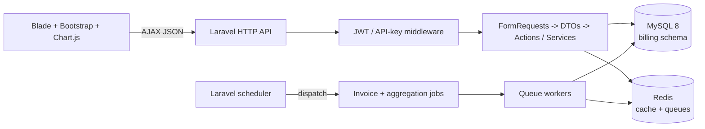

<<<<<<< HEAD
# subscription_billing_system
Design and build a small backend that meters customer usage against a subscription plan and produces billing, for a multi-tenant  SaaS-style scenario. 
=======
# Subscription Billing & Usage Metering

Multi-tenant subscription billing and usage metering built with Laravel 11,
PHP 8.3, MySQL 8, Redis, Laravel Queues, JWT authentication, Blade, Bootstrap
5, Chart.js, and Pest.

Money is stored as integer paise. Application timestamps are UTC. The system
keeps immutable usage events for auditability and maintains daily aggregates
for dashboard and invoice reads.

## Architecture



### Application boundaries

- **Controllers** are thin and delegate validation and business work.
- **Form Requests** validate input and **DTOs** carry typed application data.
- **Actions and Services** contain business workflows.
- **Eloquent models** own persistence and relationships.
- **API Resources** define JSON response shapes.
- **Jobs** handle reconciliation and cycle-end invoicing asynchronously.

## Setup and run

### Prerequisites

- PHP 8.3 with PDO MySQL
- Composer
- MySQL 8
- Redis 7+
- Node is not required
- Optional: k6 for the usage benchmark

The application runs directly on localhost at `http://localhost:8000`; no
Docker, Node build step, or frontend bundler is required.

### Clone and install step by step

1. Clone the repository and enter the project:

```powershell
git clone --branch Develop https://github.com/ganeshkumarccm/subscription_billing_system.git
cd subscription_billing_system
```

2. Apply the exercise-only Composer audit setting before dependency install:

```powershell
composer config audit.block-insecure false
```

3. Install PHP dependencies already declared in `composer.json`:

```powershell
composer install
```

4. Copy the local environment file:

```powershell
Copy-Item .env.example .env
```

5. Install the Redis client dependency and refresh the Composer autoloader:

```powershell
composer install
composer dump-autoload
```

This project uses `predis/predis`, so the PHP `redis` extension is not
required. Keep this setting in `.env`:

```dotenv
REDIS_CLIENT=predis
```

If `.env` was created before this setting was added, update
`REDIS_CLIENT=phpredis` to `REDIS_CLIENT=predis`.

6. Configure local MySQL in `.env`. The defaults expect:
   - MySQL database `billing`, user `billing`, password `billing`, port `3306`
   - Database-backed cache (no Redis service is required for migrations or seeding)

7. Generate the application and JWT secrets:

```powershell
php artisan key:generate
php artisan vendor:publish --provider="PHPOpenSourceSaver\JWTAuth\Providers\LaravelServiceProvider"
php artisan jwt:secret
```

`audit.block-insecure false` is included only for this exercise because
Composer security advisories can block Laravel 11 dependency resolution. Do
not disable advisory blocking in production; upgrade or replace affected
packages instead.

### Redis and cache configuration

The local `.env.example` uses the database cache store, so migrations and
`php artisan db:seed` do not require Redis. The cache migration must be run
before seeding:

```powershell
php artisan config:clear
php artisan migrate
php artisan db:seed
```

Redis remains configured as the queue backend. Start Redis before running a
queue worker or switch `QUEUE_CONNECTION` to `database` when Redis is not
available. If an existing `.env` still has `CACHE_STORE=redis`, change it to:

```dotenv
CACHE_STORE=database
```

Use `php artisan config:clear` after changing `.env`.

### Migrate and seed

1. Create the `billing` and `billing_test` databases and grant the local
   MySQL user access.

2. Run migrations:

```powershell
php artisan migrate
```

3. Seed the demo merchants, plans, customers, subscriptions, and users:

```powershell
php artisan db:seed
```

The demo seeder creates two merchants, three plans per merchant, 50 customers
per merchant, subscriptions including mid-cycle starts, and one user per
merchant. Demo users have password `password`.

The Acme Analytics demo login is:

```text
Email:    acme.analytics@example.test
Password: password
```

Open [http://localhost:8000/login](http://localhost:8000/login) and use these
credentials to access the dashboard.

For a large usage dataset:

```powershell
php artisan seed:usage --rows=5000000
```

This uses raw inserts in chunks of 5,000 and atomic daily aggregate upserts.

### Queue worker and scheduler

Run a Redis queue worker in a long-lived terminal:

```powershell
php artisan queue:work redis --queue=default,billing
```

Run the scheduler locally:

```powershell
php artisan schedule:work
```

The scheduler dispatches cycle-end invoice batches daily. In production, use
one cron entry running `php artisan schedule:run` every minute, or a managed
process supervisor for `schedule:work` and queue workers.

### Tests

The test database is `billing_test`, configured separately from `billing`:

```powershell
php artisan test
```

## API reference

All JSON endpoints use the `/api/v1` prefix and accept
`Accept: application/json`. JWT-protected requests use:

```http
Authorization: Bearer <jwt>
```

### Register and log in step by step

#### Option 1: Use the seeded demo account

```powershell
curl -X POST http://localhost:8000/api/v1/auth/login `
  -H "Accept: application/json" -H "Content-Type: application/json" `
  -d "{\"email\":\"acme.analytics@example.test\",\"password\":\"password\"}"
```

Copy the `access_token` from the response and use it in the authenticated
requests below.

#### Option 2: Register a new merchant

```powershell
curl -X POST http://localhost:8000/api/v1/auth/register `
  -H "Accept: application/json" -H "Content-Type: application/json" `
  -d "{\"merchant_name\":\"Acme\",\"name\":\"Admin\",\"email\":\"admin@acme.test\",\"password\":\"password123\",\"password_confirmation\":\"password123\"}"
```

Then log in with the new account:

```powershell
curl -X POST http://localhost:8000/api/v1/auth/login `
  -H "Accept: application/json" -H "Content-Type: application/json" `
  -d "{\"email\":\"admin@acme.test\",\"password\":\"password123\"}"
```

The response contains `access_token`, `token_type`, and `expires_in`.
Login is limited to five attempts per minute per email and IP.

### Authenticated dashboard and user endpoints

```powershell
curl http://localhost:8000/api/v1/auth/me `
  -H "Accept: application/json" -H "Authorization: Bearer <jwt>"

curl http://localhost:8000/api/v1/dashboard `
  -H "Accept: application/json" -H "Authorization: Bearer <jwt>"

curl -X POST http://localhost:8000/api/v1/auth/logout `
  -H "Accept: application/json" -H "Authorization: Bearer <jwt>"
```

Other JWT-protected catalog endpoints:

```text
GET  /api/v1/merchant
POST /api/v1/merchant/api-key/regenerate
GET  /api/v1/plans
GET  /api/v1/customers?search=acme&per_page=15
GET  /api/v1/customers/{customer}
GET  /api/v1/merchants/{merchant}/dashboard
```

`per_page` is capped at 50. A customer belonging to another merchant returns
`404`, not another tenant's data.

### Record usage

Usage uses the merchant API key rather than a JWT:

```powershell
curl -X POST http://localhost:8000/api/v1/usage `
  -H "Accept: application/json" -H "Content-Type: application/json" `
  -H "X-API-Key: <plain-merchant-api-key>" `
  -H "Idempotency-Key: usage-2026-11-03-0001" `
  -d "{\"customer_id\":101,\"units\":5,\"occurred_at\":\"2026-11-03T06:30:00Z\"}"
```

The first insert returns `201`. Repeating the same customer and
`Idempotency-Key` returns `200` with the original event and does not increment
the daily aggregate again. The endpoint is limited to 120 requests per minute
per API key and returns `Retry-After` on `429`.

### Plan changes

```powershell
curl -X POST http://localhost:8000/api/v1/merchants/1/subscriptions/25/change-plan `
  -H "Accept: application/json" -H "Content-Type: application/json" `
  -H "Authorization: Bearer <jwt>" `
  -d "{\"plan_id\":3,\"change_at\":\"2026-11-03T00:00:00Z\"}"
```

The URL merchant must match the token user's merchant. The subscription is
locked while its current segment is closed and the new segment is opened.

## Design decisions

### Idempotency and high-write usage

Usage events are immutable and use a unique `(customer_id, idempotency_key)`
constraint. The write transaction uses insert-ignore semantics. Only a
successful new insert performs an atomic
`INSERT ... ON DUPLICATE KEY UPDATE` against
`usage_daily_aggregates`; there is no read-modify-write race.

### Schema and indexes

The schema uses unsigned big integer identifiers and foreign keys. Raw events
retain the audit trail; aggregate rows make dashboard and invoice reads
bounded by customer-days rather than millions of events. Important access
paths have composite indexes for tenant/status/period, customer/date,
subscription/date, and aggregate date reporting.

See [docs/SCHEMA.md](docs/SCHEMA.md) for table behavior at 5M+ events and the
MySQL monthly partitioning plan.

### Daily aggregation

`usage_daily_aggregates` stores total units and event count per customer and
UTC usage date. It is updated atomically during ingestion and can be rebuilt
or reconciled by `AggregateDailyUsageJob` using grouped upserts. This keeps
dashboard and invoice queries off the high-cardinality event table.

At very high skew, the aggregate row can become a hot lock. The current
implementation favors correctness and immediate consistency; Redis buffering,
queue-based aggregation, or bucket sharding are documented alternatives.

### Caching and invalidation

Dashboard responses are cached per merchant for 60 seconds. Plan lookups use
Redis with a 10-minute TTL, `Cache::remember`, and a per-key lock to prevent
stampedes. Plan and subscription-segment observers increment a version key,
invalidating old pricing keys without relying on cache tags.

Invoices always read authoritative plan prices from the database, never from
the pricing cache.

See [docs/CACHING.md](docs/CACHING.md).

### Proration and plan changes

Billing is day-based and uses integer round-half-up arithmetic. A plan change
creates subscription segments; each segment receives its own base and overage
line item. The final base line receives any rounding remainder so invoice
lines sum exactly to the rounded total.

Segments are half-open: `starts_at <= occurred_at < ends_at`. Usage is
attributed by `occurred_at`, not by ingestion time. A subscription row is
locked during plan changes and invoice period rollover.

See [docs/BILLING.md](docs/BILLING.md) and [docs/ASSUMPTIONS.md](docs/ASSUMPTIONS.md).

### Three authentication methods

1. **JWT bearer authentication** protects the dashboard API, catalog,
   merchant, auth, and plan-change endpoints. Tokens include `merchant_id`,
   expire after 60 minutes, and are invalidated on logout.
2. **Merchant API keys** protect `POST /api/v1/usage`. Only a SHA-256 hash is
   stored; the plain key is returned once during registration/regeneration.
3. **Sanctum's `auth:sanctum` guard** remains on Laravel's generated
   `/user` baseline route from `install:api`. It is not the primary dashboard
   authentication path; JWT is used by the application API.

The Blade frontend stores the JWT in `localStorage` under `jwt`, sends it as a
Bearer header, and attempts one refresh on `401`. This is convenient for a
no-build-step take-home frontend, but JavaScript-readable storage is exposed
to XSS. A production browser client should prefer secure, HttpOnly,
SameSite cookies with CSRF protection, a stricter content-security policy, and
short-lived access tokens.

## Assumptions

- Local PHP serves the app at `http://localhost:8000`; MySQL and Redis are
  local services.
- MySQL 8.4 is used as a MySQL 8-compatible image. Production data is in
  `billing`; Pest uses a separate `billing_test` database.
- The database cache store is the default local cache store; Redis is used by
  the queue backend when queue workers are enabled.
- All timestamps are UTC and money values are integer paise.
- Late usage is accepted only when `occurred_at` falls within the customer's
  current active subscription period; events outside it are rejected.
- Usage accepts 1 through 1,000,000 units.
- `Idempotency-Key` is scoped to a customer.
- Plan changes default to the current UTC time, cannot be in the past, and are
  rejected for cancelled subscriptions.
- Midnight changes belong to the new UTC day; multiple changes per cycle are
  allowed; a last-day change is prorated for the remaining day.

The canonical list is [docs/ASSUMPTIONS.md](docs/ASSUMPTIONS.md).

## Trade-offs made under time pressure

- Blade, Bootstrap CDN, and plain JavaScript avoid a Node build pipeline and
  keep the demo easy to run, at the cost of less frontend structure and
  component reuse.
- Dashboard calculations load bounded aggregate collections into PHP. This is
  straightforward and avoids complex SQL, but a very large active-customer
  population may need SQL summaries or precomputed merchant metrics.
- Synchronous aggregate upserts provide immediate consistency and simple
  retries, but a single busy customer/day can create row lock contention.
- JWT is implemented with a small custom error middleware to distinguish
  missing, expired, and invalid tokens. The browser's localStorage token is
  practical for the exercise but not the strongest production storage model.
- The invoice job is idempotent through uniqueness and transaction checks, but
  its per-segment aggregate lookup should be consolidated before operating at
  larger scale.

## What I would do differently with more time

- Run k6 against a representative 5M+ dataset and capture p50/p95/p99,
  lock waits, deadlocks, MySQL I/O, Redis latency, and queue lag.
- Replace dashboard `whereDate` filters with sargable range predicates and
  remove the invoice job's per-segment aggregate query pattern.
- Add the subscription indexes recommended by `EXPLAIN`, after checking for
  redundancy against production cardinalities.
- Introduce monthly `RANGE` partitioning for `usage_events`, redesigning the
  global idempotency key because MySQL partitioned unique keys must include the
  partition column.
- Add a read replica for dashboard/reporting reads with an explicit freshness
  contract while keeping writes and invoice transactions on the primary.
- Consider Redis minute-buffered aggregate increments only after measuring
  contention; this would make dashboard values eventually consistent.
- Evaluate Laravel Octane after query and lock optimization, add observability,
  and migrate the browser authentication model to secure HttpOnly cookies.

## Documentation

- [Assumptions](docs/ASSUMPTIONS.md)
- [Schema and partitioning](docs/SCHEMA.md)
- [Billing and proration](docs/BILLING.md)
- [Caching and invalidation](docs/CACHING.md)
- [Dashboard queries](docs/DASHBOARD.md)
- [Queue design](docs/QUEUES.md)
- [Performance review and benchmark](docs/PERFORMANCE.md)
- [5-10 minute video checklist](docs/VIDEO-CHECKLIST.md)

## Useful commands

```powershell
php artisan serve --host=127.0.0.1 --port=8000
php artisan route:list
php artisan schedule:list
php artisan queue:failed
```
>>>>>>> 0de9ab558e1fd4cb4f26c5f051337da5fcb42cbf
